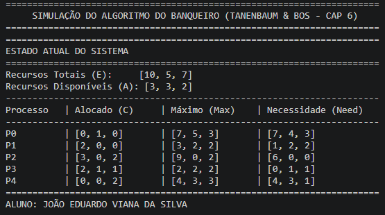
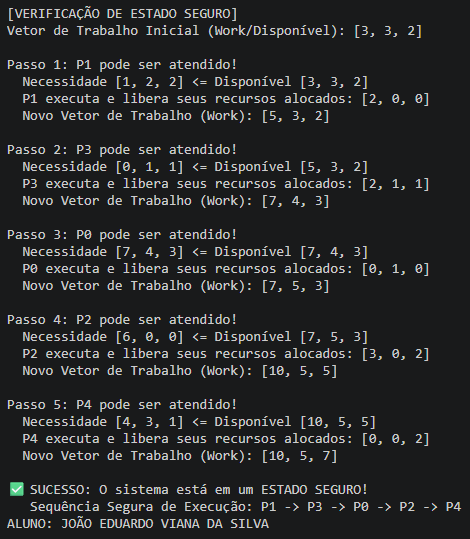
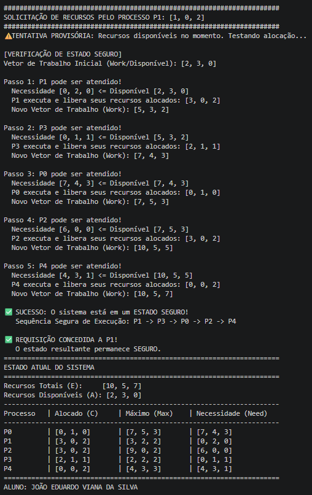
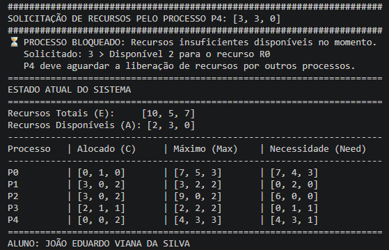

# Atividade 07 - Sistemas Operacionais

Este diretório contém a resolução da Atividade 07, que tem como objetivo evidenciar a execução do programa referente ao Algoritmo dos Banqueiros.

## Evidências de Execução

Abaixo estão as capturas de tela documentando cada etapa seguida no terminal durante a execução da atividade, acompanhadas de suas respectivas explicações:

### Estado Inicial do Sistema

**Explicação:** O algoritmo inicia avaliando a matriz de alocação atual de 5 processos (P0 a P4) disputando 3 tipos de recursos (R0, R1 e R2). Os recursos disponíveis no sistema neste momento são [3, 3, 2].

### Verificação do Estado Seguro

**Explicação:** A saída demonstra que, com os recursos disponíveis iniciais, é possível atender a todas as necessidades em cadeia, começando por P1. O sistema atesta que o estado é seguro através da sequência de execução simulada: P1 -> P3 -> P0 -> P2 -> P4.

### Teste de Caso 1 (Requisição válida de P1):

**Explicação:** O processo P1 solicita os recursos [1, 0, 2]. A requisição é validada com sucesso, pois o valor pedido é menor que a necessidade máxima declarada e há recursos suficientes disponíveis. O algoritmo executa uma alocação provisória, reduz os recursos disponíveis para [2, 3, 0] e roda o teste de segurança novamente. Uma nova sequência segura é encontrada e a requisição é efetivada.

### Teste de Caso 2 (Requisição inválida de P4):

**Explicação:** O processo P4 solicita os recursos [3, 3, 0]. O pedido falha na etapa de disponibilidade, pois P4 exige 3 unidades do recurso R0, mas o sistema possui apenas 2 unidades no momento. O algoritmo bloqueia o processo, impedindo a alocação para proteger o sistema e forçando P4 a aguardar que outros processos liberem recursos.
